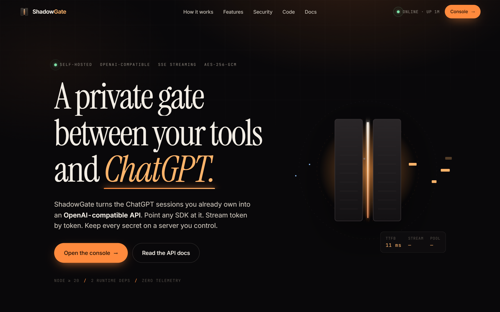
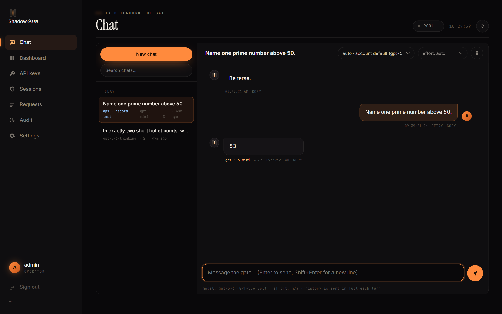
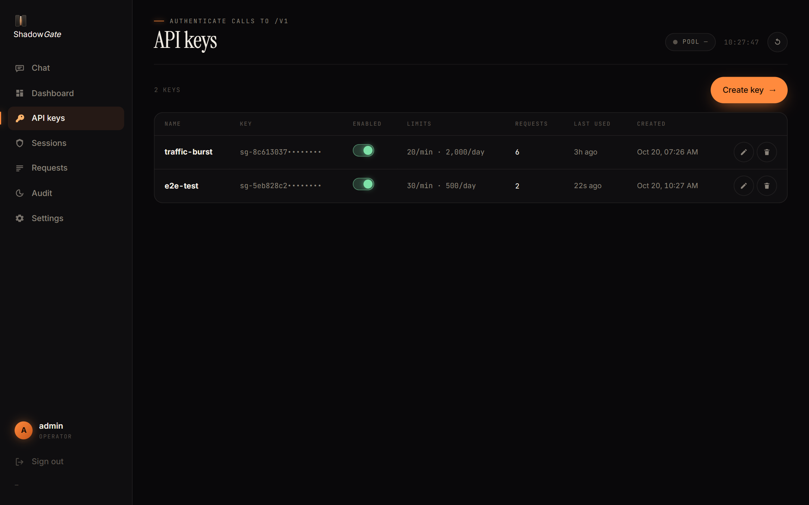
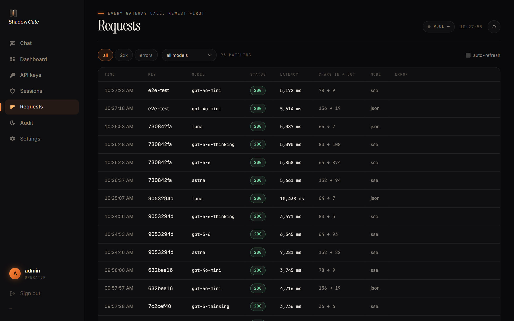
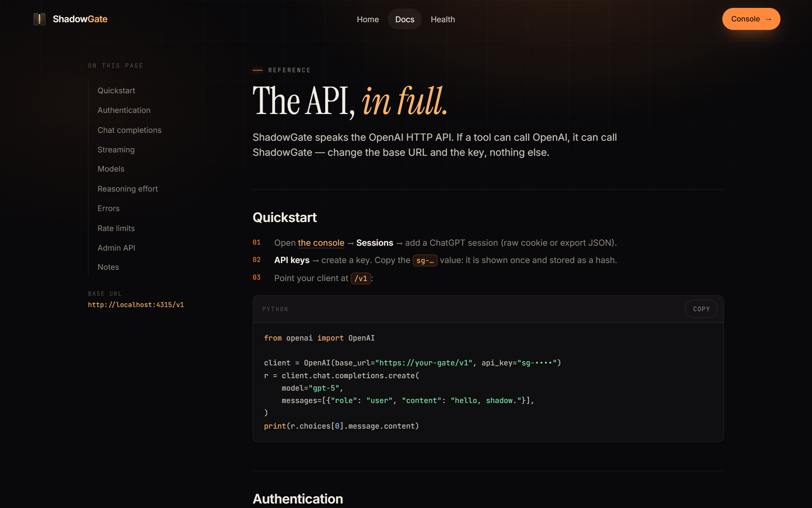
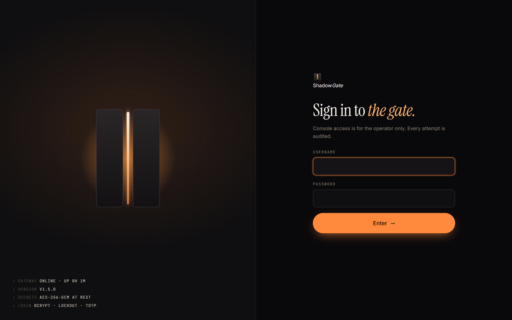
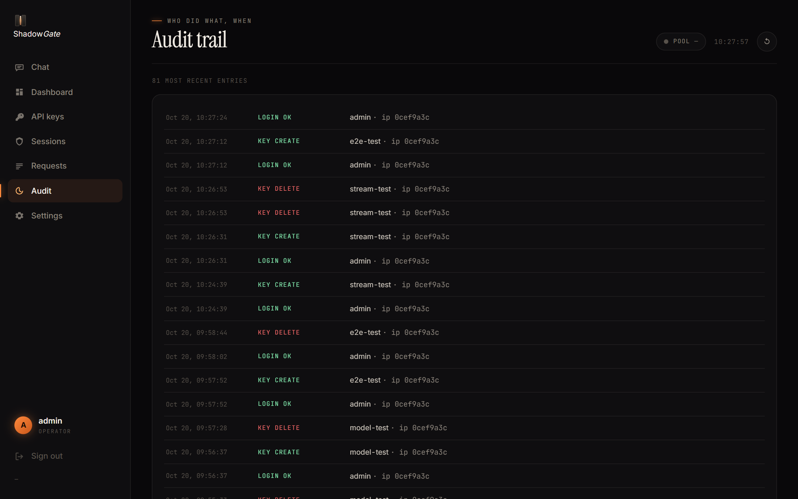
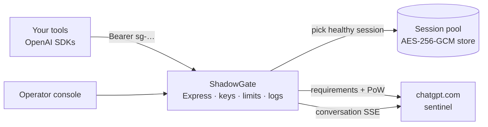

<div align="center">


# ShadowGate

**A private gate between your tools and ChatGPT.**

Turn the ChatGPT sessions you already own into a self-hosted, OpenAI-compatible API —
token streaming, managed keys, session pooling and a hardened operator console.




</div>

---

## Why

Tools speak OpenAI's HTTP API. ChatGPT accounts speak the web. ShadowGate is the translator in between — a personal, self-hosted gateway that:

- **Speaks OpenAI.** `POST /v1/chat/completions` (JSON and SSE), `GET /v1/models`, `reasoning_effort`, **function calling** (emulated on top of a backend that has none, so agent harnesses like OpenCode work), OpenAI-shaped errors, CORS for browser clients. Change one line — the base URL.
- **Knows the real models.** The catalog is discovered from each account (`gpt-5-6`, `gpt-5-6-thinking`, `gpt-5-6-pro`, mini, instant) plus the real GPT-6 family as work-mode rows (`gpt-6-astra-wm`, `gpt-6.1-sol-wm`, `gpt-6-luna-wm` — metered by ChatGPT's work credits) and the unmetered chat lane listed honestly as `gpt-6`: the chat endpoint answers every GPT-6 name without `-wm` with the same model, so the gateway sends them all there and labels the reply `gpt-6`. Exact slugs pass through, OpenAI names and codenames resolve to the right model, and `reasoning_effort` becomes ChatGPT's standard or extended thinking.
- **Knows your limits.** `GET /v1/usage` and the console show each account's 5-hour and weekly usage windows (the chatgpt.com Usage page), credits and when each window resets. Ask the model "what's my usage?" from ZadLoop, OpenCode or any client and it answers from the live numbers.
- **Sees images.** `image_url` parts (data: or http URLs) are uploaded to the account's file service the way chatgpt.com does it and attached to the message; every model lists `input_modalities: ["text", "image"]`.
- **One honest row per model.** `/v1/models` lists real slugs only, each with its own title, real context window, reasoning efforts and modalities, so harness pickers show the main models and nothing else.
- **Continues conversations instead of re-uploading them.** A request that is the previous conversation plus new messages sends only the new messages into the backend conversation it already has; edited histories fall back to a full resend, links survive restarts, and the part the backend already held is reported as cached tokens. Usage caps on one account fail over to the next session for the same model.
- **Tested.** `npm test` runs a regression suite against recorded backend streams: the parser, the tool protocol, compaction, model resolution, images and the continuation cache.
- **Never dies on a long agent session.** When a harness sends more history than the backend's ~480k-character budget, the gateway condenses the middle of the conversation with a fast model (every identifier, number and decision kept; long middles summarised in parts) and only clips as a last resort, saying so in an `x-shadowgate-compacted` header.
- **Streams token by token.** ChatGPT's event stream is re-framed live as `chat.completion.chunk` frames with clean `[DONE]` framing. If the client disconnects, the upstream conversation is aborted so no quota is wasted.
- **Pools your sessions.** Least-recently-used rotation, automatic access-token refresh, cooldown on throttling, hourly retries of expired sessions, a health check every ten minutes.
- **Is hardened end to end.** bcrypt logins with per-visitor lockout (2FA codes count as strikes too), optional TOTP, signed HttpOnly sessions, CSRF double-submit, AES-256-GCM encrypted secrets, per-key rate limits, strict CSP with zero inline scripts, hashed IPs, full audit trail.
- **Has a console you'll actually open.** A built-in chat with a conversation sidebar (pick any real model and thinking effort, streaming replies, markdown, retry, search), live dashboard, request log, key and session management, audit trail, keyboard shortcuts — vanilla HTML/CSS/JS with no build step. Optionally records `/v1` traffic as read-only transcripts in the same sidebar.
- **Stays auditable.** Three runtime dependencies (`express`, `bcryptjs`, `gpt-tokenizer` for exact token counts). No telemetry. The only outbound connections go to `chatgpt.com`.

## Screenshots

| Chat | API keys |
|---|---|
|  |  |

| Request log | API docs |
|---|---|
|  |  |

| Sign-in | Audit trail |
|---|---|
|  |  |

## Quickstart

### Docker

```bash
git clone https://github.com/Lucifer-xD/shadowgate.git && cd shadowgate
cp .env.example .env         # set SECRET_KEY + ADMIN_PASSWORD (BIND_HOST=0.0.0.0 inside the container)
docker compose up -d         # gateway on 127.0.0.1:4315 — put nginx/Caddy TLS in front
```

Everything the gateway stores — API keys, encrypted sessions, settings, logs — lives in `/app/data` (the `shadowgate_data` volume). To keep it in a host folder instead, mount `./data:/app/data` and make it writable by the container user first: `mkdir -p data && sudo chown -R 10001:10001 data`. The gateway refuses to start when its data directory is not writable, rather than running with amnesia.

### Manual

```bash
npm install && npm run build
cp .env.example .env         # fill it in
npm start                    # http://localhost:4315  (console at /admin)
```

Then:

1. Open **`/admin`** and sign in with `ADMIN_USERNAME` / `ADMIN_PASSWORD` (or the generated password printed on first boot).
2. **Sessions → Add session** — paste your `__Secure-next-auth.session-token` cookie, or better, a full session export JSON. ShadowGate keeps the export's device id and user agent, which keeps anti-bot challenges away.
3. **API keys → Create key** — copy the `sg-…` key. It is shown once and stored as a SHA-256 hash.
4. Call it like OpenAI:

```bash
curl http://localhost:4315/v1/chat/completions \
  -H "Authorization: Bearer sg-••••" \
  -H "Content-Type: application/json" \
  -d '{"model":"gpt-5","messages":[{"role":"user","content":"hello, shadow."}],"stream":true}'
```

```python
from openai import OpenAI
client = OpenAI(base_url="https://your-gate/v1", api_key="sg-••••")
```

Full reference: **`/docs`** on your deployment, or [docs/API.md](docs/API.md).

## Configuration

Everything lives in `.env` (see [.env.example](.env.example)):

| Variable | Default | Purpose |
|---|---|---|
| `PORT` | `4315` | Listen port |
| `BIND_HOST` | `0.0.0.0` | Interface to bind — use `127.0.0.1` behind a reverse proxy |
| `PUBLIC_BASE_URL` | `http://localhost:4315` | Public URL (drives the Secure cookie flag) |
| `SECRET_KEY` | *required* | HMAC for admin sessions + AES-256-GCM key for stored tokens |
| `ADMIN_USERNAME` / `ADMIN_PASSWORD` | `admin` / generated | Console credentials (rotate in-app; `ADMIN_PASSWORD_RESET=1` forces a reset) |
| `SESSION_TOKENS` | — | Comma-separated session tokens imported on boot |
| `DEFAULT_KEY_RPM` / `DEFAULT_KEY_RPD` | `120` / `20000` | Default per-key rate limits (agent loops make one request per tool round) |
| `TRUST_PROXY` | `0` | Reverse-proxy hops to trust for the client IP (`1` behind nginx/Caddy) |
| `ADMIN_IP_ALLOWLIST` | — | Optional CIDR allowlist for `/admin` |

## Security

- Session and access tokens are **AES-256-GCM encrypted** with a key derived from `SECRET_KEY`. A stolen `data/store.json` is useless without it.
- API keys are stored as **SHA-256 hashes**; the full key is displayed exactly once.
- Console login: **bcrypt(12)**, timing-flat comparisons, five strikes → 15-minute lockout per visitor (wrong 2FA codes count), optional **TOTP 2FA**, signed **HttpOnly SameSite=Strict** sessions with server-side revocation, **CSRF** double-submit on every mutation.
- Every response ships a strict **CSP** (`script-src 'self'`, no inline scripts — enforced in CI), `X-Frame-Options: DENY`, `nosniff`, a referrer policy; APIs are `no-store`. IPs are hashed in logs; admin actions are audited.
- Rate limits are sliding windows per key (rpm/rpd); malformed bodies, oversized payloads and quota caps all return OpenAI-shaped errors.

Details: [docs/SECURITY.md](docs/SECURITY.md).

## Architecture



More depth in [docs/ARCHITECTURE.md](docs/ARCHITECTURE.md).

## Repository layout

```
src/
  chatgpt/   PoW solver, session refresh, sentinel handshake, SSE translator
  gateway.ts OpenAI-compatible API (/v1): auth, limits, retries, streaming
  engine.ts  Shared completion engine: session pick, model resolve, stream, retry
  chats.ts   Console chat: conversations store + SSE endpoint, API transcript capture
  admin.ts   Console API (login, lockout, TOTP, CSRF, stats, CRUD, audit)
  pool.ts    Session pool: rotation, cooldown, health loop
  store.ts   Encrypted-at-rest JSON store (atomic, debounced writes)
web/         Landing page, docs, console SPA — vanilla, zero build, CSP-clean
scripts/     e2e test, session verifier/seeder, screenshot generator, CSP guard
deploy/      systemd unit, nginx vhost (+ Cloudflare real-ip), Caddyfile, installers
```

## Development

```bash
npm run dev          # build + start
npm test             # typecheck + CSP guard for web/
node scripts/e2e-test.mjs          # login → key → models → completion + stream (needs a session in the pool)
node scripts/verify-session.mjs "path/to/export.json"   # check a session against chatgpt.com
node scripts/screenshot.mjs        # regenerate docs/screenshots via headless Edge
```

## Disclaimer

ShadowGate interoperates with ChatGPT's web backend for personal use. It is not affiliated with OpenAI; automating the web app may violate their terms of use. Run it for yourself, with your own accounts, at your own risk.

## License

[MIT](LICENSE) © Lucifer
